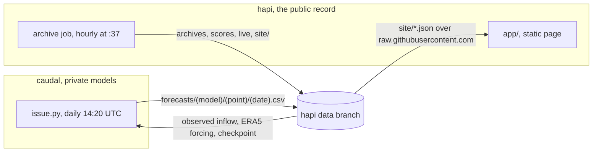
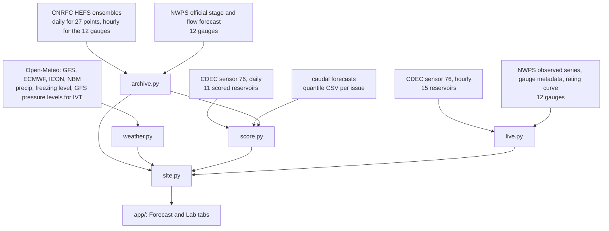
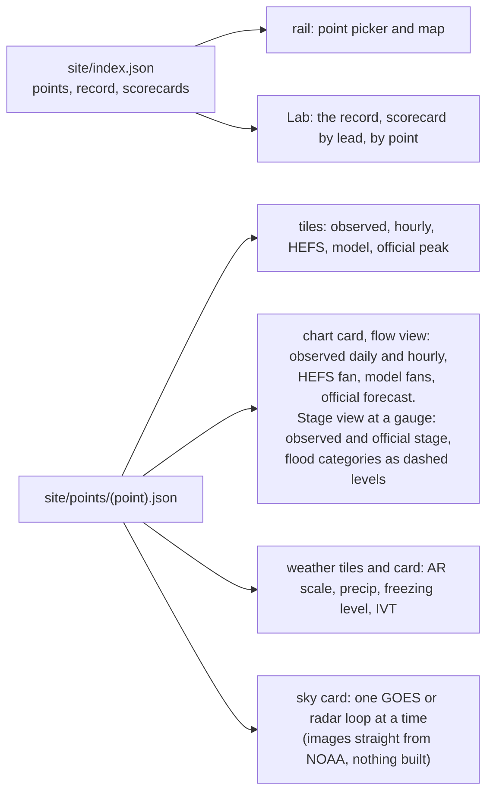

# Architecture

How hapi is put together and how the data flows through it. Written 2026-11-16; it describes what runs,
not a plan. The companion package [caudal](https://github.com/sotarolab/caudal) makes the model forecasts.

hapi is the public record. It archives the official river forecasts as they are issued, receives model
forecasts as files, fetches observations and weather, scores every forecast against what happened, and
serves the result as a static page. It makes no forecasts of its own.

## The five rules

**Archive wide, score narrow.** Every product for every point is saved on every run, including points whose
observations are too noisy to score. CNRFC keeps its own dated copies of the 12Z HEFS issues since January
2014; whether the NWS official forecast can be recovered later was not checked.

**Never revise.** A forecast file is written once. A corrected model is a new product with a new name.

**Before the outcome.** A model forecast counts only if it was committed to the `data` branch before the day
it predicts. The commit time is the proof.

**The referee does not import the player.** The scripts use only the Python standard library and never import
caudal. Scores come from this repository's own code, with its own tests.

**Python computes, the page draws.** Every number, label, unit and colour on the page is written by
`site.py`. The page takes its files from one address (`DATA_BASE` in `app/src/api.ts`) and computes nothing
when a visitor opens it.

## The two repositories



`main` holds code only and deploys the page. `data` holds everything the jobs write and is the only thing
the two repositories share. Caudal reads its inputs from it and commits its forecasts back; hapi never
reads caudal's code.

## One hourly run

```mermaid
sequenceDiagram
  participant A as archive.py
  participant W as weather.py
  participant S as score.py
  participant L as live.py
  participant B as site.py
  participant D as data branch
  A->>D: hefs_daily/, hefs_hourly/, nwps_forecast/ (new issues only)
  W->>D: weather/ (a point only when its newest file is 5 h old)
  S->>D: cdec_inflow/ refreshed, scores/inflow_daily.csv rewritten
  L->>D: live/(point).json rewritten (hourly flow, flood categories)
  B->>D: site/index.json, site/points/(point).json rewritten
  Note over A,D: one commit per run; a run that changes nothing commits nothing
```

The weather step has its own five-minute timeout and continues on error, so a stalled Open-Meteo hour loses
only the weather. Everything else runs in the order shown, each script reading what the previous ones wrote.

## Where the data comes from



| Folder on `data` | Written by | Content |
|---|---|---|
| `hefs_daily/`, `hefs_hourly/` | `archive.py` | HEFS ensembles as fetched, one gzip per point and issue |
| `nwps_forecast/` | `archive.py` | The NWS official stage and flow forecast for the gauges |
| `weather/` | `weather.py` | One derived file per point and fetch: hourly series per model, IVT |
| `cdec_inflow/` | `score.py` | Observed daily inflow, full record, refetched every run (CDEC revises) |
| `forecasts/<model>/<point>/` | caudal | Model quantile forecasts, one file per issue, never rewritten |
| `forcing/` | caudal | The daily forcing each issue used, extended run by run |
| `scores/` | `score.py` | One row per scored forecast day, product, point and lead |
| `live/` | `live.py` | The week's hourly flow per point and each gauge's flood categories in cfs |
| `site/` | `site.py` | The JSON the page reads: `index.json` and `points/<point>.json` |

## What the page draws from



Each pane in `app/src/components/` draws one part of the file and knows nothing about hydrology: the weather
pane, for instance, draws whatever tiles and series `site.py` wrote, with their labels and colours.

## The pieces

| Piece | Holds |
|---|---|
| `points.py` | The 15 reservoirs and 12 gauges: names, coordinates, USGS ids |
| `archive.py` | Feeds and the fetch and save helpers the other scripts share; CDEC station per reservoir |
| `weather.py` | Open-Meteo fetch, IVT from the pressure levels, the derived file |
| `ar_scale.py` | The atmospheric river scale of Ralph et al. (2019) on hourly IVT |
| `contract.py` | The rules a model forecast file and its manifest meet, and their check |
| `score.py` | Observations, fair CRPS, 90% coverage, persistence and climatology baselines, leads 1 to 14 |
| `retro.py` | Past HEFS issues from CNRFC's dated archive into a hindcast folder that `score.py` scores unchanged |
| `live.py` | Hourly flow and flood categories, read off the NWS rating curve where NWPS gives only the stage |
| `site.py` | Everything the page shows, as data |
| `app/` | Vite, React, Leaflet and uPlot; the map, one chart per point, the panes, the scorecards |
| `tests/` | One test file per script; the page has its own Vitest suite |
| `.github/workflows/archive.yml` | The hourly job; commits to `data` |
| `.github/workflows/pages.yml` | Builds and deploys the page on a push to `main` that touches `app/` |

## The contract with caudal

Files, not code. A forecast is `forecasts/<model>/<point>/<issue date>.csv` with columns `date`, `lead`, then
one column per quantile named `qNN` in increasing order (caudal writes `q05` to `q99`), in cfs, one row per
lead day counted from the issue date in the file name. `contract.py` states the rules and checks every file:
`score.py` leaves out one that breaks them and says so, scores the rest beside HEFS with no change to the
code, and `site.py` draws the newest good one beside the HEFS fan. An hourly forecast is the same file named
for its issue hour, `<YYYY-MM-DD>T<HH>Z.csv`, with `time` in place of `date` and one row per lead hour; it is
checked and drawn, and not scored yet. A product may carry
`forecasts/<model>/MODEL.json` naming the model, its commit and its checkpoint; caudal checks the same rules
before it writes, and one real issued file is the fixture that keeps the two checks equal.

## The hindcast

`retro.py` reads CNRFC's dated archive (`<YYYYMMDD>12_<group>_hefs_csv_daily.zip`, one zip per river group
and day, since January 2014) and writes each reservoir point's issue day and 14 leads to
`<folder>/hefs_daily/<point>/<YYYYMMDD>T120000Z.gz`, the layout `archive.py` saves. It reads only the start
of each zip, 32 to 128 KB of 1 to 3 MB. `python score.py <folder>` then scores it with the code that scores
the live record, and a model hindcast under `<folder>/forecasts/` is scored beside it.

The hindcast and the live record are never pooled. A live forecast reached the `data` branch before the day
it predicts; a hindcast has no such proof. The hindcast folder is ignored by git and the page does not read it.

## Limits to know about

- **History size.** Every run that changes something is committed, hourly, and git keeps all of it. If the
  `data` branch nears 1 GB, the raw archives move to file storage and git keeps their checksums.
- **A HEFS day is not a Pacific day.** A daily HEFS row stamped 12Z is the mean of the 24 hours before it,
  04:00 to 04:00 Pacific standard time. `score.py` pairs it with the day before its stamp, the Pacific day
  CDEC's value describes, which holds 20 of those 24 hours. Lead 1 is the day after the issue.
- **Observations are revised.** CDEC edits past values, so a score can change after the fact. Forecasts never do.
- **CDEC's hourly inflow is computed** from storage and release and is noisy. The page shows a centred
  24-hour mean, only at reservoirs whose hourly values over the week vary less than their mean (four of
  fifteen on 2026-11-16), and treats zero hours as missing, which is what CDEC writes when a component
  sensor is down. Even there the mean runs up to about 15% off CDEC's daily value.
- **Flood categories are stages.** They are drawn in feet in a gauge's stage view. For the text that says
  which category a flow reaches, NWPS gives category flows for 3 of the 12 gauges; the rest are read off the
  gauge's NWS rating curve, and a category above the curve's top has no flow.
- **Site address.** The page is served under the repository name, so a rename changes it.

## Not built yet

- A `qc` workflow that runs the Python tests on pull requests; today only the page's tests run, in the deploy.
- Scoring the gauges: the hourly HEFS and the official forecast against the NWS observed series.
- The `MODEL.json` manifest itself, which caudal writes; hapi already reads it.
- Exceedance probability per gauge: the share of the ensemble above each flood category.
- A meteorology pane: the NWS forecast discussion and the official NWPS and CNRFC plots.
